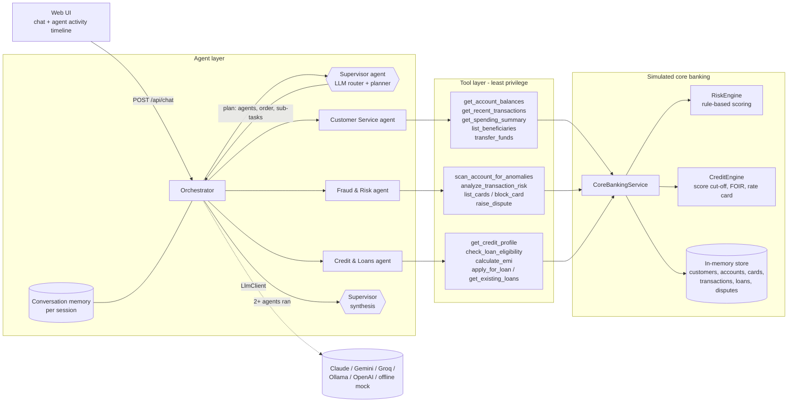
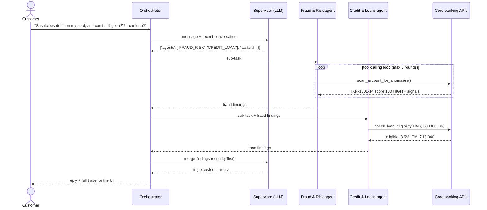

# Architecture and approach

## 1. Goal

The goal is to show how several AI agents can cooperate inside a (simulated) bank. One agent understands the
customer and plans the work. Specialist agents act within narrow, auditable permissions. Every number the customer
sees comes from a banking system, not from the model's imagination.

## 2. High-level architecture

## 3. Request lifecycle

## 4. Components

**Supervisor agent** (`agents/supervisor.py`). It makes one LLM call with a routing prompt that returns strict JSON:
which agents to run, in what order, a self-contained sub-task for each, and a direct reply for greetings or
off-topic messages. It sees the recent conversation, so short follow-ups ("yes, go ahead", "block it") go back to
the agent that asked the question. When more than one specialist runs, a second call merges their findings into one
reply.

**Orchestrator** (`agents/orchestrator.py`). It runs the Supervisor's plan **sequentially**, so later agents receive earlier
agents' findings as context. In the example above, the loan agent knows about the fraud before answering. It then
stores the turn in session memory and returns the reply with an execution trace.

**Specialist agents** (`agents/specialist.py`, wired in `build_agents()`). Each one is a domain system prompt, an allow-listed
tool set and a tool-calling loop: call the model, execute any requested tools, feed the results back, and repeat
until the model answers. The loop is capped by an iteration budget. All three agents use the same class and differ
only in configuration, so adding a fourth agent (for example "Investments") is a prompt, a tool subset and an enum
value.

**Tools** (`tools/toolkit.py`). Each tool is a JSON-schema contract plus a handler. The same definition is sent to any
LLM provider, and each client translates it to its native format.

**Simulated core banking** (`bank/service.py`, `bank/risk.py`, `bank/credit.py`, `bank/store.py`). These are plain
Python services, also exposed as REST endpoints (`/api/bank/...`) so they can be tested without any AI involved.

**LLM abstraction** (`llm/base.py`). There are three implementations behind one interface:
- `AnthropicClient` (native Messages API tool use)
- `OpenAICompatibleClient` (OpenAI, Gemini, Groq, Ollama, LM Studio, vLLM, ...)
- `MockLlmClient` (offline, deterministic, used for tests and keyless demos)

Swapping to an "experimental" model is a configuration change, not a code change.

## 5. Key design decisions

| Decision | Why |
|---|---|
| **Supervisor + specialists** instead of one large agent | Smaller prompts and tool sets per agent mean more reliable tool selection, clearer accountability, and per-domain permissions. It also mirrors how bank teams are organised. |
| **LLM decides, deterministic code computes** | Risk scores, EMIs, FOIR and eligibility come from deterministic Python engines. The model chooses *which* calculation to run and *explains* the result, but never produces the numbers itself. This makes outputs reproducible, testable and auditable, which matters for regulated decisions. |
| **Least-privilege tools per agent** | Only Customer Service can move money and only Fraud & Risk can block cards. If a model requests a tool it wasn't granted, the call is refused and recorded in the trace. |
| **Identity injected by the server, not the model** | Tools get `customer_id` from the authenticated session (`ToolContext`). No tool schema has a customer-id parameter, so even a prompt injection like "show CUST1002's balance" cannot reach another customer's data. |
| **Human-in-the-loop for money movement** | Transfers are two-step: preview (with risk check), then explicit confirmation in a later message. The tool itself enforces `confirmed=true`, so this isn't just a prompt instruction. |
| **Risk check on the transaction path** | Every transfer is scored in real time (new payee, share of balance, amount, odd hours, recent card fraud). HIGH-risk transfers are placed **ON_HOLD** rather than executed, which is where the Customer Service and Fraud domains meet. |
| **Sequential hand-off with shared findings** | It's simpler and more predictable than agents chatting freely, and it's enough for cross-domain requests. Parallel fan-out is an easy extension for independent sub-tasks. |
| **Graceful degradation** | If the routing JSON can't be parsed, a keyword router takes over. If synthesis fails, findings are concatenated. Tool errors (insufficient funds, unknown card) are returned to the model as data so it can explain them. |
| **Full traceability** | Every route decision, tool call, argument, result and timing is recorded and shown in the UI. In a bank this becomes the audit log. |
| **Vendor-neutral, no SDK** | Plain HTTP (`httpx`) and JSON keep dependencies minimal and make it easy to try new or experimental models side by side. |

## 6. Guardrails implemented

- Customer data scoping enforced in code (session `customer_id`, never model-supplied).
- Per-agent tool allow-lists, with refusals logged.
- Confirmation gate and risk-based hold on transfers. Daily transfer limit and balance checks live in the banking layer.
- Prompts tell the Supervisor to refuse off-topic requests and to ignore instructions to bypass rules or reveal other customers' data.
- Tool-iteration cap per agent (no runaway loops). The message size limit is validated at the API.
- Agents are instructed never to state figures that didn't come from a tool. The synthesis step must preserve figures and IDs exactly.

## 7. What is simulated, and the production path

| MVP | Production equivalent |
|---|---|
| In-memory `BankDataStore` seeded at startup | Core banking system (e.g. Finacle / T24) behind an API gateway; read replicas for queries |
| Customer picker in the UI | OAuth2 / OIDC login, step-up auth (OTP) for transfers and card actions |
| Rule-based `RiskEngine` | ML fraud model plus a rules engine, fed by a real-time transaction stream (Kafka) so the Fraud agent can also act **proactively** on alerts, not only when asked |
| Rule-based `CreditEngine` | Credit bureau APIs (CIBIL / Experian), underwriting service, policy engine |
| In-process tool calls | Tools as authenticated service calls (or MCP servers) with idempotency keys, timeouts, circuit breakers |
| In-memory conversation memory | Redis with TTL, and PII masking before anything is sent to an external LLM |
| Trace in the HTTP response | OpenTelemetry spans plus an immutable audit store; LLM evaluation and regression suites per agent |
| Synchronous request/response | Streaming responses (SSE) so the timeline fills in live |

## 8. Testing

`pytest` runs 23 tests in under a second, with no network or API key:
- `test_engines.py`: EMI formula, risk scoring of the fraud pattern versus normal spend, the anomaly scan, FOIR decline, score cut-off, balance checks, preview vs confirmed vs held transfers, Indian number formatting.
- `test_mock_parsing.py`: Indian amount formats ("₹1,20,000", "5 lakh"), tenures, and the fallback router.
- `test_api.py`: end to end over HTTP through Supervisor, agents, tools and bank: routing, fraud detection, the confirm-then-hold transfer flow using conversation memory, multi-agent synthesis, tool allow-lists, validation errors, the bank REST APIs.
- `test_llm_wire_format.py`: full tool round trips through the Anthropic and OpenAI-compatible clients against scripted fake responses. It checks tool_use / tool_result blocks, `tool_calls`, routing JSON wrapped in markdown fences, and amounts sent as strings like "3,00,000".

## 9. Known limitations and next steps

- Agents run sequentially; independent sub-tasks could run in parallel.
- No streaming of tokens or trace events yet (SSE would make the timeline live).
- The mock model is only meant for keyless demos and tests; it shows raw tool output instead of prose.
- Add an evaluation set of ~50 labelled prompts to measure routing accuracy and tool-call correctness per model, so different models can be compared objectively.
